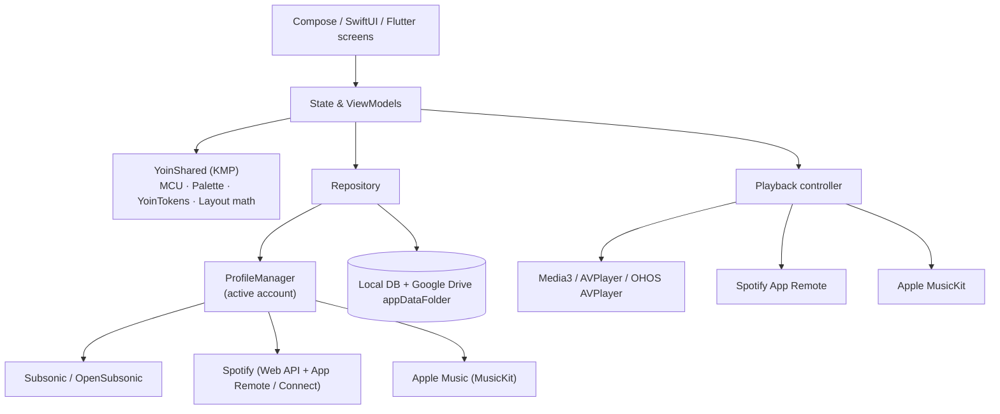

# Yoin

[](https://github.com/p2o51/Yoin/actions/workflows/ci.yml)

**Sound after sound.**

Listen across your own server (Subsonic / OpenSubsonic), Spotify and Apple Music, and keep what each song meant to you. The native rewrite and successor to Spotoolfy, designed with Material 3 Expressive in mind for phones, foldables, tablets and desktops.

[简体中文](README.zh-CN.md) · [Website](https://yoin.gojyuplus.com) · [中文官网](https://yoin.gojyuplus.com/zh/) · [Docs](https://yoin.gojyuplus.com/docs.html) · [Design & engineering notes](https://yoin.gojyuplus.com/#notes)

<!-- Hero GIF: export yoin-hero.gif (and yoin-hero-dark.gif, if there is one) to docs/media/, then use:
<picture>
  <source media="(prefers-color-scheme: dark)" srcset="docs/media/yoin-hero-dark.gif">
  
</picture>
-->

## Leave a trace on the music you hear.

Write down how the arrangement, a lyric or a mix makes you feel, even the fan chant. As ratings and notes add up, the albums you return to become **Memories** of their own.

- **Quick ratings.** Slide the rating bar beside the cover to score tracks and albums down to `0.1`.
- **Timestamped notes.** Each note pins to the second it was written, scrolls alongside the lyrics, and jumps back to that moment on tap.
- **Album Memories & All Memories.** Albums you rate across most tracks or annotate become Memories with a record-groove emblem and a listening diary. Pull down on Home or open the **All Memories** module to flip through your listening history.
- **A few music tools, kept on a short leash.**
  - **Lyrics:** Line-synced lyrics with bilingual translation and **Focus** mode on a tap of the cover.
  - **About:** Credits and recording background gathered through your own API key (Gemini 3.1 Flash-Lite with Google Search, or custom OpenAI / Anthropic endpoints paired with DeepSeek, Exa or Volcengine Doubao). Save answers to the album's **Scrapbook**, or translate the full lyric.
  - **What others say:** NeoDB rating distributions and listener reviews right on the album page or inside a Memory's diary, with optional two-way sync for your own ratings and reviews.

## All your music, in one place.

Sign in to several servers, Spotify and Apple Music accounts at once, and move between them in the same interface without signing out.

- **Your own server:** Direct streaming from Navidrome, Gonic and other OpenSubsonic servers, with original quality, ReplayGain and offline downloads.
- **Spotify:** Reads your personal library and controls playback through the Spotify app or Spotify Connect. When a signed-in Spotify account is playing, a live track capsule floats to the top of Home on Android for one-tap switching.
- **Apple Music:** Browses your library and the full catalog, playing natively through Apple MusicKit.
- **Quick switching:** Long-press the avatar in the top bar and slide to switch accounts, or tap an album or playlist from **In Your Other Libraries** on Home to switch and play in one step.
- **Local-first by design:** No ads and no Yoin account. Ratings, notes and listening history are saved on-device; music-source passwords and tokens are encrypted on-device and excluded from system backups. Ratings and notes sync across devices through your own Google Drive (`appDataFolder` hidden space).

## At home in your palm and on the big screen.

We rethought what a music app's Home is made of, and brought the responsive design refined since Spotoolfy to your iPhone, your Pixel, a Galaxy Z Fold 8, even a Googlebook.

- **One navigation bar that never leaves.** The same floating bar becomes a bottom bar on a phone, a centered bar on a tablet, and a bar that spans two columns when a detail page opens beside the library. Each slot's width comes from one pure function, so no frame shows a gap.
  [`YoinButtonGroup.kt`](app/src/main/java/com/gpo/yoin/ui/component/YoinButtonGroup.kt) ·
  [`FloatingBottomBar.kt`](app/src/main/java/com/gpo/yoin/ui/component/FloatingBottomBar.kt) ·
  [`WindowAdaptiveRuntime.kt`](app/src/main/java/com/gpo/yoin/ui/experience/WindowAdaptiveRuntime.kt) ·
  [`docs/adaptive-principles.md`](docs/adaptive-principles.md)
- **Predictive back built from AOSP's own numbers.** Outside the two-column layout, detail pages are separate Activities. Their back gesture ports the platform's cross-activity animation constant for constant, so leaving a page feels like the system did it while the navigation bar stays pixel-still underneath.
  [`BackMotionTokens.kt`](app/src/main/java/com/gpo/yoin/ui/navigation/back/BackMotionTokens.kt) ·
  [`DetailPredictiveBackCollapse.kt`](app/src/main/java/com/gpo/yoin/ui/detail/DetailPredictiveBackCollapse.kt) ·
  [`DetailBackEntering.kt`](app/src/main/java/com/gpo/yoin/ui/navigation/back/DetailBackEntering.kt)
- **A covered window that stopped drawing.** A Perfetto trace showed that the window behind a detail page still rendered every frame. Pausing its frame clock brought expanded lyrics on a Pixel Tablet from ~80% CPU down to ~20%.
  [`CoveredWindowAnimationGate.kt`](app/src/main/java/com/gpo/yoin/ui/experience/CoveredWindowAnimationGate.kt) ·
  commit [`ec1dc15f`](https://github.com/p2o51/Yoin/commit/ec1dc15f03526272141c228a46c0ef02995f195f)
- **Keyboard shortcuts and pointer hover.** Connect a keyboard, stylus or trackpad on a Mac, HarmonyOS PC or Googlebook to control playback, search, and jump between Home, Library and All Memories.

## Design and engineering notes

- [**Testing “About” on 499 songs**](https://yoin.gojyuplus.com/blog-499.html) ([中文](https://yoin.gojyuplus.com/zh/blog-499.html)) — Benchmarking web search providers and models across 499 tracks, nine genres and three eras to find where accuracy, restraint and speed meet.
- [**The navigation bar that never leaves**](https://yoin.gojyuplus.com/blog-bar.html) ([中文](https://yoin.gojyuplus.com/zh/blog-bar.html)) — Keeping a single floating navigation bar pixel-still across windows, breakpoints and predictive back.
- [**Pre-save: Yoin**](https://yoin.gojyuplus.com/blog-presave.html) ([中文](https://yoin.gojyuplus.com/zh/blog-presave.html)) — From Spotoolfy to a native rewrite: where Yoin came from and what lives inside it.

## Tech stack

### Shared Kotlin Multiplatform (`:shared` → `YoinShared.xcframework`)

- **Design & layout engine:** Material Color Utilities (`SPEC_2025` Expressive color scheme roles), `androidx.palette` color-cut quantizer port, `YoinTokens` (shared layout, typography, motion and glass tokens), Now Playing column budget, album spectrum, fast-scroller math, and Scrapbook FNV-1a tilts
- **Data & lyrics:** Ktor client (`OkHttp` on Android, `Darwin` / `NSURLSession` on iOS) for Subsonic / OpenSubsonic, `kotlinx.serialization`, and a shared LRC / structured-lyrics parser
- **Cross-platform parity:** Verified by 1,152-role MCU golden fixtures and digest tests across JVM and the iOS simulator (`./gradlew :shared:allTests`)

### Android (`app/`, versions in [`gradle/libs.versions.toml`](gradle/libs.versions.toml))

- **Core:** Kotlin 2.4.21, AGP 9.2.1, `minSdk` 26, `targetSdk` 36, `compileSdk` 37
- **UI & Motion:** Jetpack Compose (BOM 2026.09.00), Material 3 `1.5.0-alpha27` (Expressive APIs), Material 3 Adaptive `1.3.0`, `androidx.window` `1.5.1`, Navigation 3 `1.1.2`, Glance `1.2.0` (home-screen widgets)
- **Playback:** Media3 `1.11.1` (`MediaSession` + Cast), Spotify App Remote, Apple MusicKit
- **Storage, Sync & AI:** Room `2.8.5`, AndroidKeyStore AES-GCM credential encryption, Google Drive `appDataFolder` sync, Retrofit `3.0.0`, OkHttp `5.5.1`, Coil `3.4.0`, ML Kit GenAI Prompt `1.0.0-beta4` (on-device Gemini Nano)
- **Tests:** JUnit 4, Robolectric `4.17`, Turbine `1.2.1`, MockK `1.14.11`

### iOS and iPadOS (`iosApp/`)

- **Core & UI:** Swift 6.0 (strict concurrency), SwiftUI, iOS 26 (Liquid Glass and custom Yoin glass layers), iPad split-column adaptive layout, XcodeGen (`project.yml`)
- **Playback:** `AVPlayer` + `MPNowPlayingInfoCenter` / `MPRemoteCommandCenter` (Subsonic), `MusicKit` for Swift (Apple Music), `SpotifyiOS` `5.0.1` App Remote + Web API (Spotify)
- **Storage, Sync & On-Device AI:** Keychain credential storage, `GoogleSignIn` `9.2.0` (`drive.appdata` cloud sync shared with Android), Apple Intelligence / Foundation Models (on-device lyric highlights)
- **Widgets & Live Activities:** WidgetKit and ActivityKit (`YoinWidgets`)

### HarmonyOS (`harmony/`)

- **UI & Runtime:** Flutter for OpenHarmony (`3.41.10-ohos`, Dart `3.11.5`), DevEco Studio API 26
- **Native Modules:** ArkTS modules for audio playback, `AVSession`, background tasks, and home-screen form cards

### Icons ([Yoin Symbols](https://github.com/p2o51/yoin-symbols))

- 173 rounded line icons drawn for Yoin with an even `1.5` stroke and continuous-curvature corners. One source ships to Jetpack Compose, Android Views, iOS SF Symbol templates (`YoinSymbols.xcassets`), Flutter, Figma and SVG.



Every provider implements the [`MusicSource`](app/src/main/java/com/gpo/yoin/data/source/MusicSource.kt) interface and maps into neutral domain models. Providers declare their `Capability` set so the UI adapts cleanly to what each service supports.

## Platforms and status

- **Android (`0.6.3`):** In closed testing on Google Play for Android 8.0+. Join in about two minutes via [yoin.gojyuplus.com](https://yoin.gojyuplus.com).
- **iOS and iPadOS (`0.6.3`):** In development for iPhone, iPad and Mac, with multi-account playback, Memories, All Memories, Apple Intelligence lyric cards, iPad split layouts and Google Drive sync shared with Android.
- **HarmonyOS (`harmony/`):** Native HarmonyOS version in development for phones and 2-in-1 PCs.

## Build

### Android (`app/`)

Requires JDK 17+ (Android Studio's bundled JBR works) and the Android SDK for API 37 (`compileSdk`), plus two external dependencies:

1. **Apple MusicKit for Android:** Download `musickitauth-release-1.1.2.aar` and `mediaplayback-release-1.1.1.aar` from Apple Developer and place them in `app/libs/` (see [`app/libs/README-apple-music.md`](app/libs/README-apple-music.md)).
2. **Yoin Symbols:** Clone [p2o51/yoin-symbols](https://github.com/p2o51/yoin-symbols) alongside this repository (`../yoin-symbols`), or pass `-PyoinSymbolsDir=<path>`.

```bash
./gradlew assembleDebug   # debug APK
./gradlew test            # unit tests
./gradlew ktlintCheck     # lint
```

### iOS (`iosApp/`) & HarmonyOS (`harmony/`)

- **iOS:** Requires Xcode 26+ and `xcodegen`. The Xcode scheme pre-action builds `:shared` into `YoinShared.xcframework` automatically (`cd iosApp && xcodegen generate && xcodebuild -project Yoin.xcodeproj -scheme Yoin build`).
- **HarmonyOS:** Requires DevEco Studio 26.0.0+ (API 26) and Flutter for OpenHarmony; see [`harmony/README.md`](harmony/README.md).

For service setup (Subsonic, Spotify Client ID, Apple Music developer token endpoint), see the [user docs](https://yoin.gojyuplus.com/docs.html). See [`CONTRIBUTING.md`](CONTRIBUTING.md) and [`docs/ci-cd.md`](docs/ci-cd.md) for the PR and release flow.

## License

[Apache-2.0](LICENSE). Third-party notices are in [`NOTICE`](NOTICE).
