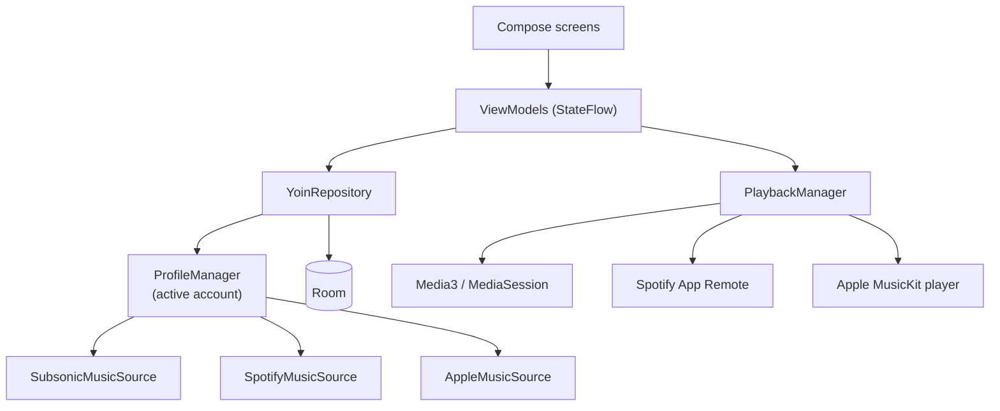

# Yoin

[](https://github.com/p2o51/Yoin/actions/workflows/ci.yml)

An Android music client for Subsonic, Spotify and Apple Music, designed for phones, foldables and tablets.

<!-- Hero GIF: export yoin-hero.gif (and yoin-hero-dark.gif, if there is one) to docs/media/, then use:
<picture>
  <source media="(prefers-color-scheme: dark)" srcset="docs/media/yoin-hero-dark.gif">
  
</picture>
-->

Ratings, notes and Memories stay on the device. Cloud sync to your own Google Drive is optional.

## Highlights

**One navigation bar that adapts to the window.** The same bar becomes a bottom bar on a phone,
a centered bar on a tablet, and a bar that spans two columns when a detail page opens beside the
library. Each slot's width comes from one pure function, so no frame shows a gap.
[`YoinButtonGroup.kt`](app/src/main/java/com/gpo/yoin/ui/component/YoinButtonGroup.kt),
[`FloatingBottomBar.kt`](app/src/main/java/com/gpo/yoin/ui/component/FloatingBottomBar.kt),
[`WindowAdaptiveRuntime.kt`](app/src/main/java/com/gpo/yoin/ui/experience/WindowAdaptiveRuntime.kt),
[`docs/adaptive-principles.md`](docs/adaptive-principles.md)

**Predictive back built from AOSP's own numbers.** Outside the two-column layout, detail pages are separate Activities. Their back
gesture is a port of the platform's cross-activity animation, constant for constant, so leaving a page
feels like the system did it. The navigation bar stays put while the page underneath moves.
[`BackMotionTokens.kt`](app/src/main/java/com/gpo/yoin/ui/navigation/back/BackMotionTokens.kt),
[`DetailPredictiveBackCollapse.kt`](app/src/main/java/com/gpo/yoin/ui/detail/DetailPredictiveBackCollapse.kt),
[`DetailBackEntering.kt`](app/src/main/java/com/gpo/yoin/ui/navigation/back/DetailBackEntering.kt)

**A covered window that kept drawing.** A Perfetto trace showed that the window behind a detail page
still rendered every frame. Pausing its frame clock, plus a few smaller cuts, brought expanded lyrics
on a Pixel Tablet from about 80% CPU to about 20%.
[`CoveredWindowAnimationGate.kt`](app/src/main/java/com/gpo/yoin/ui/experience/CoveredWindowAnimationGate.kt),
commit [`ec1dc15f`](https://github.com/p2o51/Yoin/commit/ec1dc15f03526272141c228a46c0ef02995f195f)

## Screenshots

<!-- Add docs/media/screenshot-phone.png, screenshot-foldable.png and screenshot-tablet.png, then use:
| Phone | Foldable | Tablet |
| --- | --- | --- |
|  |  |  |
-->

## Tech stack

Versions are taken from [`gradle/libs.versions.toml`](gradle/libs.versions.toml).

- Kotlin 2.3.20, Android Gradle Plugin 9.1.0, minSdk 26, targetSdk 36
- Jetpack Compose (BOM 2026.03.01), Material 3 1.5.0-alpha16 with the Expressive APIs
- Navigation 3 1.1.2 for the detail column on large screens
- Media3 1.10.0 with a `MediaSession` playback service
- Room 2.8.4 for local data, kotlinx.serialization 1.8.0
- Retrofit 2.11.0 and OkHttp 5.0.0-alpha.14, Coil 3.4.0 for images
- Glance 1.2.0 for home-screen widgets
- MVVM with `StateFlow`, manual dependency injection
- Tests: JUnit 4, Robolectric 4.16.1, Turbine 1.2.0, MockK 1.13.16



Every provider implements the same `MusicSource` interface and uses the same neutral models. A provider
declares which capabilities it supports, and the UI hides what a provider can't do.
See [`MusicSource.kt`](app/src/main/java/com/gpo/yoin/data/source/MusicSource.kt).

## How this was built

Most of the implementation code was written by AI coding agents. I made the product and design
decisions, tested on real devices, and set the direction when something broke. The rules the agents
follow are in [`AGENTS.md`](AGENTS.md), [`docs/`](docs) and the unit tests.

## Status

In closed testing on Google Play.

## Known issues

- Spotify playback needs Spotify Premium and the Spotify app on the same device.
- Apple Music: a queue of more than 300 songs starts as a 100-song window around the selected song.
  Play next and Add to queue with more than 300 songs are not handled yet.
- Apple Music sometimes refuses library reads for a few minutes. The cause is unknown. Playlists that
  exist only in the library can't be opened during that time.

## Build

You need JDK 17 or newer (Android Studio's bundled JBR works) and the Android SDK for API 36.

The project does not build without these:

- **Apple MusicKit for Android.** Apple doesn't allow redistributing it, so it isn't in this repository.
  Download the SDK from Apple's developer site and put `musickitauth-release-1.1.2.aar` and
  `mediaplayback-release-1.1.1.aar` in `app/libs/`. See
  [`app/libs/README-apple-music.md`](app/libs/README-apple-music.md).
- **Yoin Symbols**, the icon set. Until it is on Maven Central, clone
  [p2o51/yoin-symbols](https://github.com/p2o51/yoin-symbols) next to this repository
  (`../yoin-symbols`), or pass `-PyoinSymbolsDir=<path>`.

Each music service also needs your own credentials:

- **Subsonic / OpenSubsonic:** a server URL and account, entered in the app.
- **Spotify:** a Client ID from the Spotify Developer Dashboard, with this app's package name and
  signing certificate SHA-1 registered for Android. Enter it in Settings, or build with
  `-PspotifyClientId=<id>`.
- **Apple Music:** an HTTPS endpoint that issues MusicKit developer tokens. A small reference service is in
  [`services/apple-music-token/`](services/apple-music-token). Enter its URL in Settings.

```bash
./gradlew assembleDebug   # debug APK
./gradlew test            # unit tests
./gradlew ktlintCheck     # lint
```

See [`CONTRIBUTING.md`](CONTRIBUTING.md) for the pull request flow and [`docs/ci-cd.md`](docs/ci-cd.md)
for CI and release setup.

## License

[Apache-2.0](LICENSE). Third-party notices are in [`NOTICE`](NOTICE).
