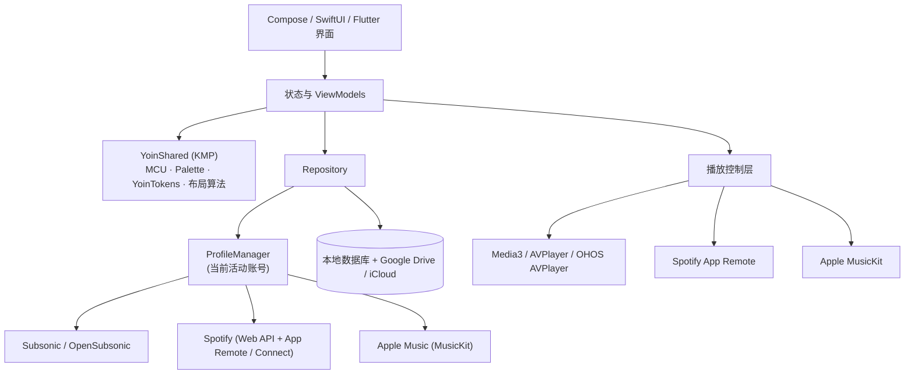

# Yoin

[](https://github.com/p2o51/Yoin/actions/workflows/ci.yml)

**音犹未尽。**

在自建服务器（Subsonic / OpenSubsonic）、Spotify 与 Apple Music 聆听音乐与记录回忆，以 Material 3 Expressive 为灵感设计。Spotoolfy 的原生重写续作，适配手机、折叠屏、平板与桌面大屏。

[English](README.md) · [中文官网](https://yoin.gojyuplus.com/zh/) · [English Website](https://yoin.gojyuplus.com) · [使用文档](https://yoin.gojyuplus.com/zh/docs.html) · [设计与工程手记](https://yoin.gojyuplus.com/zh/#notes)

## 为听过的音乐留下痕迹。

你可以记录对当前配乐、歌词或编曲的感受，甚至记录应援词。当评分与笔记慢慢积累，常听的专辑会生成专属的 **Memories**。

- **快速评分**：轻轻滑动封面旁的评分条，记录精确到 `0.1` 的曲目与专辑评分。
- **记录笔记**：笔记将锚定在进度条对应的秒数，随歌词同步滚动，轻点即可跳回当时的片段。
- **专辑 Memories 与全部 Memories**：你的记录会回响变成余音，在 App 中翻看带唱片刻纹徽记与听歌日记的专辑 Memories，或在首页下拉、通过“全部 Memories”组件回顾全部听歌轨迹。
- **我们克制地为你提供了这些音乐工具，希望你不要讨厌。**
  - **歌词看看**：跟着逐行同步的歌词一起听，轻点封面即可进入聚焦模式。通过提供商或 AI 获取翻译。
  - **背景看看**：打开“关于”，通过你配置的 API 密钥（支持 Gemini 3.1 Flash-Lite + Google 搜索，或 OpenAI / Anthropic 兼容接口搭配 DeepSeek、Exa、火山豆包）检索并整理歌曲幕后班底与录制背景。随时提出你的问题，把发现收进专辑**剪贴簿**，或翻译整首歌词。
  - **别人看看**：在专辑页或 Memories 日记中打开“别人怎么说”，查看 NeoDB 上的评分分布与听众评论；连接账号后，也可以同步你自己的专辑评分与评论。

## 让所有音乐存放在一处。

同时接入多个自建服务器、Spotify 与 Apple Music 账号，不用反复退出或登录，即可在同一套界面里随时切换。

- **自建服务器**：直连 Navidrome、Gonic 等 OpenSubsonic 服务，支持原始音质、音量平衡与离线下载。
- **Spotify**：读取个人资料库，通过 Spotify 应用或 Spotify Connect 远程播放与控场。当已登录的 Spotify 账号正在播放，Android 首页顶部会浮出曲目胶囊，轻点即可切换。
- **Apple Music**：浏览个人资料库与完整曲库，通过 Apple MusicKit 原生播放。
- **快速切换**：长按顶栏头像并滑动即可切到另一个账号；首页的“在你的其他资料里”组件还会列出其他账号常听的专辑与播放列表，点按即可切换并播放。
- **本地优先**：没有广告，不设 Yoin 账号，Yoin 不收集你听了什么。评分、笔记和播放记录保存在本机；音源密码和令牌经系统安全密钥库加密保存在本机，不进入系统备份。评分、笔记与歌单备份可通过你的 Google Drive（应用专用的 `app-data` 隐藏空间）或 Apple 端私有 iCloud 数据库（CloudKit）在设备之间同步。

## 从掌心到大屏，处处合手。

从原点思考音乐 App 首页的构造，从 Spotoolfy 开始积累的响应式设计经验，在您的 iPhone、Pixel 设备、Galaxy Z Fold 8 甚至 Googlebook 上都有精美流畅的体验。

- **从不离开的导航栏**：Yoin 里所有页面都在运动之中，唯独底部的浮动栏始终停在原处——在手机上是底栏，在平板上居中收拢，在宽屏打开详情页时横跨双栏。三个按钮的宽度由同一个纯函数算出，任何一帧都不会漏出缝隙。
  [`YoinButtonGroup.kt`](app/src/main/java/com/gpo/yoin/ui/component/YoinButtonGroup.kt) ·
  [`FloatingBottomBar.kt`](app/src/main/java/com/gpo/yoin/ui/component/FloatingBottomBar.kt) ·
  [`WindowAdaptiveRuntime.kt`](app/src/main/java/com/gpo/yoin/ui/experience/WindowAdaptiveRuntime.kt) ·
  [`docs/adaptive-principles.md`](docs/adaptive-principles.md)
- **跟手的预测性返回手势**：双栏之外，详情页是独立的 Activity。我们把 AOSP 跨 Activity 返回动画的曲线与常量原样搬进 Compose，页面跟随手指收拢退回，而底栏纹丝不动。
  [`BackMotionTokens.kt`](app/src/main/java/com/gpo/yoin/ui/navigation/back/BackMotionTokens.kt) ·
  [`DetailPredictiveBackCollapse.kt`](app/src/main/java/com/gpo/yoin/ui/detail/DetailPredictiveBackCollapse.kt) ·
  [`DetailBackEntering.kt`](app/src/main/java/com/gpo/yoin/ui/navigation/back/DetailBackEntering.kt)
- **被遮挡窗口的帧时钟门控**：Perfetto 抓迹发现详情页背后的主窗口仍在逐帧重绘。暂停被遮挡窗口的帧时钟后，Pixel Tablet 上展开歌词时的 CPU 占用从约 80% 降至约 20%。
  [`CoveredWindowAnimationGate.kt`](app/src/main/java/com/gpo/yoin/ui/experience/CoveredWindowAnimationGate.kt) ·
  commit [`ec1dc15f`](https://github.com/p2o51/Yoin/commit/ec1dc15f03526272141c228a46c0ef02995f195f)
- **键盘快捷键与指针悬停**：连上键盘、手写笔或触控板，在你的 Mac、鸿蒙 PC 或 Googlebook 上使用 Yoin。用快捷键即可播控、搜索或切换首页、资料库与全部 Memories。

## 设计与工程手记。

- [**关于 499 首歌的“关于”测试**](https://yoin.gojyuplus.com/zh/blog-499.html) — 横跨九类曲风与三个年代的 499 首歌实测，对比主流外接搜索与模型在歌曲幕后班底检索上的准确率、克制程度与响应速度。
- [**从不离开的导航栏**](https://yoin.gojyuplus.com/zh/blog-bar.html) — 如何让同一条浮动导航栏跨越多个窗口与断点，在预测性返回中纹丝不动。
- [**预先收藏：Yoin**](https://yoin.gojyuplus.com/zh/blog-presave.html) — Spotoolfy 之后是 Yoin：它从哪儿来，里面都有什么。

## 技术栈

### 跨平台共享层（`:shared` → `YoinShared.xcframework`）

- **设计令牌与布局算法**：Kotlin Multiplatform 构建，双端共用 Material Color Utilities（`SPEC_2025` Expressive 动态色彩角色）、`Palette` 色彩量化算法、`YoinTokens`（布局、字阶、动效与玻璃质感常量）、正在播放页纵向高度预算、专辑光谱提取、快速滚动条数学模型及剪贴簿 FNV-1a 倾角算法
- **网络与歌词解析**：基于 Ktor（Android 走 `OkHttp`，iOS 走 `Darwin` / `NSURLSession`）的 Subsonic / OpenSubsonic 客户端、`kotlinx.serialization` 以及共用的 LRC / 结构化歌词解析器
- **双端一致性校验**：通过 1,152 项 MCU 金标准夹具与跨平台摘要单测，保证 JVM 与 iOS 模拟器运算结果逐位一致（`./gradlew :shared:allTests`）

### Android（`app/`，版本号见 [`gradle/libs.versions.toml`](gradle/libs.versions.toml)）

- **基础环境**：Kotlin 2.4.21、AGP 9.2.1、`minSdk` 26、`targetSdk` 36、`compileSdk` 37
- **界面与动效**：Jetpack Compose (BOM 2026.11.01)、Material 3 `1.5.0` (Expressive APIs)、Material 3 Adaptive `1.3.0`、`androidx.window` `1.5.1`、Navigation 3 `1.1.2`、Glance `1.2.0`（桌面小组件）
- **播放内核**：Media3 `1.11.1`（`MediaSession` + Cast）、Spotify App Remote、Apple MusicKit
- **本地存储、同步与端侧 AI**：Room `2.8.5`、AndroidKeyStore AES-GCM 凭证加密、Google Drive `appDataFolder` 同步、Retrofit `3.0.0`、OkHttp `5.5.1`、Coil `3.4.0`、ML Kit GenAI Prompt `1.0.0-beta5`（端侧 Gemini Nano）
- **测试**：JUnit 4、Robolectric `4.17`、Turbine `1.2.1`、MockK `1.14.11`

### iOS 与 iPadOS（`iosApp/`）

- **基础与界面**：Swift 6.0（严格并发检查）、SwiftUI、iOS 26（Liquid Glass 与 Yoin 自定义玻璃层级）、iPad 分栏自适应布局、XcodeGen（`project.yml`）
- **播放内核**：`AVPlayer` + `MPNowPlayingInfoCenter` / `MPRemoteCommandCenter`（Subsonic）、`MusicKit` for Swift（Apple Music）、`SpotifyiOS` `5.0.1` App Remote + Web API（Spotify）
- **存储、同步与端侧 AI**：Keychain 凭证加密存储、`GoogleSignIn` `9.2.0`（与 Android 互通的 `drive.appdata` 云同步）与 Apple iCloud（CloudKit 私有库，支持四步校验迁移）、Apple Intelligence / Foundation Models（端侧歌词卡片生成）
- **小组件与实时活动**：WidgetKit 与 ActivityKit（`YoinWidgets`）

### 鸿蒙（`harmony/`）

- **界面与运行时**：Flutter for OpenHarmony（`3.41.10-ohos`，Dart `3.11.5`）、DevEco Studio API 26
- **原生模块**：ArkTS 编写的音频播放、`AVSession` 播控、后台任务与桌面卡片模块

### 图标系统（[Yoin Symbols](https://github.com/p2o51/yoin-symbols)）

- 为 Yoin 绘制的 173 个圆润线条图标，统一 `1.5` 线宽与连续曲率转角。同一份源文件同时构建 Jetpack Compose、Android View、iOS SF Symbol 模板（`YoinSymbols.xcassets`）、Flutter、Figma 与 SVG。



所有音源统一实现 [`MusicSource`](app/src/main/java/com/gpo/yoin/data/source/MusicSource.kt) 接口并映射为中立领域模型；各音源声明自身支持的 `Capability` 集合，界面据此自动隐藏当前音源不支持的操作。

## 平台状态

- **Android (`0.6.3`)**：正在 Google Play 封闭测试（需 Android 8.0+），前往 [yoin.gojyuplus.com/zh/](https://yoin.gojyuplus.com/zh/) 约两分钟即可加入。
- **iOS 与 iPadOS (`0.6.3`)**：开发中，已具备多账号播放、Memories、全部 Memories、基于 Apple Intelligence 的歌词卡片、iPad 分栏布局及与 Android 互通的 Google Drive 同步。
- **鸿蒙 (`harmony/`)**：原生鸿蒙版本正在开发中，适配鸿蒙手机与二合一 PC。

## 构建

### Android（`app/`）

需要 JDK 17+（可使用 Android Studio 自带的 JBR）以及 Android SDK API 37 (`compileSdk`)，并准备两项外部依赖：

1. **Apple MusicKit for Android**：从 Apple Developer 下载 `musickitauth-release-1.1.2.aar` 与 `mediaplayback-release-1.1.1.aar` 放入 `app/libs/`（详见 [`app/libs/README-apple-music.md`](app/libs/README-apple-music.md)）。
2. **Yoin Symbols**：将 [p2o51/yoin-symbols](https://github.com/p2o51/yoin-symbols) 克隆至同级目录 (`../yoin-symbols`)，或在构建时传入 `-PyoinSymbolsDir=<路径>`。

```bash
./gradlew assembleDebug   # 构建 debug APK
./gradlew test            # 运行单元测试
./gradlew ktlintCheck     # 代码格式检查
```

### iOS（`iosApp/`）与鸿蒙（`harmony/`）

- **iOS**：需要 Xcode 26+ 与 `xcodegen`。Xcode Scheme 的构建前置脚本会自动将 `:shared` 编译为 `YoinShared.xcframework`（`cd iosApp && xcodegen generate && xcodebuild -project Yoin.xcodeproj -scheme Yoin build`）。
- **鸿蒙**：需要 DevEco Studio 26.0.0+（API 26）与 Flutter for OpenHarmony，详见 [`harmony/README.md`](harmony/README.md)。

各音源与在线 AI 的配置步骤见[使用文档](https://yoin.gojyuplus.com/zh/docs.html)。PR 与发布流程见 [`CONTRIBUTING.md`](CONTRIBUTING.md) 与 [`docs/ci-cd.md`](docs/ci-cd.md)。

## 开源协议

[Apache-2.0](LICENSE)。第三方开源库声明见 [`NOTICE`](NOTICE)。
